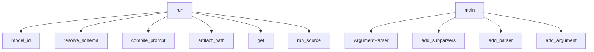

# System Architecture Analysis
<!-- generated in 0.00s -->

## Overview

- **Project**: /home/tom/github/if-uri/urivision
- **Primary Language**: python
- **Languages**: python: 8, txt: 5, shell: 2, toml: 1
- **Analysis Mode**: static
- **Total Functions**: 15
- **Total Classes**: 4
- **Modules**: 16
- **Entry Points**: 3

## Architecture by Module

### src.urivision
- **Functions**: 3
- **File**: `__init__.py`

### src.urivision.resolver
- **Functions**: 3
- **File**: `resolver.py`

### src.urivision.runner_litellm
- **Functions**: 2
- **File**: `runner_litellm.py`

### src.urivision.validators
- **Functions**: 2
- **Classes**: 1
- **File**: `validators.py`

### src.urivision.dsl
- **Functions**: 2
- **Classes**: 3
- **File**: `dsl.py`

### src.urivision.cli
- **Functions**: 1
- **File**: `cli.py`

### src.urivision.schemas
- **Functions**: 1
- **File**: `schemas.py`

### src.urivision.compiler
- **Functions**: 1
- **File**: `compiler.py`

## Key Entry Points

Main execution flows into the system:

### src.urivision.runner_litellm.run
> Wykonaj proces VURI: obraz+prompt → model → DecisionCard (zwalidowany schematem).
dry_run zwraca wkompilowane wywołanie bez uderzania w model (do test
- **Calls**: src.urivision.resolver.model_id, src.urivision.schemas.resolve_schema, src.urivision.compiler.compile_prompt, src.urivision.resolver.artifact_path, None.get, completion, json.loads, src.urivision.resolver.artifact_path

### src.urivision.cli.main
- **Calls**: argparse.ArgumentParser, ap.add_subparsers, sub.add_parser, r.add_argument, r.add_argument, r.add_argument, ap.parse_args, dict

### src.urivision.run
- **Calls**: src.urivision.run_source

## Process Flows

Key execution flows identified:

### Flow 1: run
```
run [src.urivision.runner_litellm]
  └─ →> model_id
  └─ →> artifact_path
  └─ →> resolve_schema
```

### Flow 2: main
```
main [src.urivision.cli]
```

## Key Classes

### src.urivision.validators.VuriValidationError
- **Methods**: 0
- **Inherits**: ValueError

### src.urivision.dsl.Model
- **Methods**: 0

### src.urivision.dsl.Process
- **Methods**: 0

### src.urivision.dsl.VuriSyntaxError
- **Methods**: 0
- **Inherits**: ValueError

## Data Transformation Functions

Key functions that process and transform data:

### src.urivision.validators.validate
- **Output to**: VuriValidationError, src.urivision.validators._scheme, p.input_mime.startswith, VuriValidationError, p.output_schema.startswith

### src.urivision.dsl._parse_options
- **Output to**: v.strip, _OPT.findall

### src.urivision.dsl.parse
> Parsuj źródło .vuri → AST procesu. Rzuca VuriSyntaxError na niepoprawnej instrukcji.
- **Output to**: Process, text.splitlines, None.strip, line.partition, rest.strip

## Public API Surface

Functions exposed as public API (no underscore prefix):

- `src.urivision.dsl.parse` - 35 calls
- `src.urivision.runner_litellm.run` - 17 calls
- `src.urivision.cli.main` - 13 calls
- `src.urivision.validators.validate` - 10 calls
- `src.urivision.resolver.artifact_path` - 8 calls
- `src.urivision.compiler.compile_prompt` - 6 calls
- `src.urivision.run_source` - 3 calls
- `src.urivision.run_file` - 3 calls
- `src.urivision.schemas.resolve_schema` - 1 calls
- `src.urivision.run` - 1 calls
- `src.urivision.resolver.label` - 1 calls
- `src.urivision.resolver.model_id` - 0 calls

## System Interactions

How components interact:



## Reverse Engineering Guidelines

1. **Entry Points**: Start analysis from the entry points listed above
2. **Core Logic**: Focus on classes with many methods
3. **Data Flow**: Follow data transformation functions
4. **Process Flows**: Use the flow diagrams for execution paths
5. **API Surface**: Public API functions reveal the interface

## Context for LLM

Maintain the identified architectural patterns and public API surface when suggesting changes.